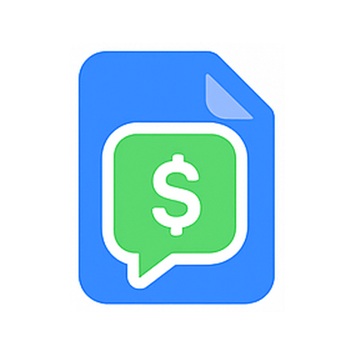

<p align="center"></p>

# QuoteBill MCP server

Draft quotations, invoices and the other documents of a sale from the AI assistant you already use. QuoteBill's remote MCP server gives ChatGPT, Claude, Gemini and any other MCP client:

- **Ten kinds of document**: quotation, invoice, proforma invoice, receipt, credit note, purchase order, delivery note, work order, statement of account and commercial invoice
- **536 templates** for trades, professional services, countries and languages, covering every kind
- **Tax rules for 195 countries**, each with the official source it was read from and the date it was checked
- **Totals** worked out with the same arithmetic as the QuoteBill editor, rounded to the currency
- **A link to the finished document**: `build_document` returns a URL that opens the drafted document, filled in, on [quotebill.com](https://quotebill.com), ready to download as Excel or Word or to save as a PDF
- **The next document in the flow**: `next_document` turns a drafted quotation into its invoice, an invoice into its receipt, credit note or delivery note, and so on, keeping the parties, lines, tax and language
- **Sample contracts and forms to read**: `list_contract_templates` and `get_contract_template` find QuoteBill's sample contracts; `search_forms` and `get_form` find forms in its Forms Top 100, such as an NDA, an employment contract or a resignation letter, with the countries and languages each comes in (samples and templates, not legal, tax or accounting advice)

| | |
|---|---|
| Endpoint | `https://quotebill.com/mcp` |
| Transport | Streamable HTTP (JSON responses) |
| Authentication | OAuth 2.1 with a free QuoteBill account. Your AI app finds the sign-in by itself: it opens QuoteBill, you sign in (Google works) and choose **Allow** |
| Protocol | 2026-07-28, and the handshake revisions 2025-03-26 to 2025-11-25 |
| Languages | Answers in 33 languages |
| Guide for people | [Use QuoteBill in ChatGPT, Claude and Gemini](https://quotebill.com/en/guides/connect-ai-assistants/) |
| MCP Registry | `io.github.auto1225/quotebill` |

## Connect

The first time you connect, your AI app opens QuoteBill in the browser. Sign in or sign up free, check which app is asking, and choose **Allow**. You do this once per app; you can disconnect an app at any time under **Connected AI apps** in QuoteBill's company settings.

**Claude** (claude.ai, desktop and mobile) — Settings → Connectors → Add custom connector. Name `QuoteBill`, URL `https://quotebill.com/mcp`, then **Connect**. Or open this link: [add QuoteBill to Claude](https://claude.ai/customize/connectors?modal=add-custom-connector&connectorName=QuoteBill&connectorUrl=https%3A%2F%2Fquotebill.com%2Fmcp).

**ChatGPT** (chatgpt.com) — turn on developer mode in Settings, then create an app from the apps page: MCP server URL `https://quotebill.com/mcp`, authentication *OAuth*. Sign in to QuoteBill and allow it, then add QuoteBill from the **+** menu in a chat.

**Claude Code**

```sh
claude mcp add --transport http quotebill https://quotebill.com/mcp
```

Then run `/mcp`, choose `quotebill` and sign in.

**Codex** — `~/.codex/config.toml`, then `codex mcp login quotebill`

```toml
[mcp_servers.quotebill]
url = "https://quotebill.com/mcp"
```

**Gemini CLI** — install this repository as an extension:

```sh
gemini extensions install https://github.com/auto1225/quotebill-mcp
```

or add it to `~/.gemini/settings.json`:

```json
{ "mcpServers": { "quotebill": { "httpUrl": "https://quotebill.com/mcp" } } }
```

Then run `/mcp auth quotebill` once to sign in.

**Cursor** — `.cursor/mcp.json` (Cursor opens the sign-in when you enable the server)

```json
{ "mcpServers": { "quotebill": { "url": "https://quotebill.com/mcp" } } }
```

**VS Code** — `.vscode/mcp.json` (VS Code asks you to sign in when the server starts)

```json
{ "servers": { "quotebill": { "type": "http", "url": "https://quotebill.com/mcp" } } }
```

**Claude Code plugin** — this repository is also a plugin marketplace:

```sh
/plugin marketplace add auto1225/quotebill-mcp
/plugin install quotebill@quotebill
```

### How the sign-in works

A request without a token gets `401` with `WWW-Authenticate: Bearer resource_metadata="https://quotebill.com/.well-known/oauth-protected-resource/mcp"`. That metadata (RFC 9728) names the authorization server, Supabase Auth at `https://wgpfbcfiontxqusseoyv.supabase.co/auth/v1`, whose metadata (RFC 8414) offers dynamic client registration, PKCE and the `email` scope. MCP clients that follow the MCP authorization specification need nothing else.

## Tools

| Tool | What it does |
|---|---|
| `search_templates` | Finds templates by words, document type, category or country, in the language asked for, with example line items and the page each opens on. |
| `get_template` | The full record for one template slug, with its example line items. |
| `get_tax_rule` | The published rate, its name, the currency and the source it was read from, for any of 195 countries; where invoices may have to be e-invoices, the system. |
| `calculate_totals` | Adds up line items, applies discounts and the country's tax, rounding each tax component separately to the currency. |
| `build_document` | Builds a complete document of any of the ten kinds from line items, optionally from a template, and returns a link that opens it filled in on quotebill.com. |
| `next_document` | Makes the next document from the link `build_document` or `next_document` returned: a quotation becomes an invoice, an invoice a receipt, and so on. |
| `calculate_tax` | The VAT and GST calculator: adds tax to a net amount or takes it out of a gross one, with an optional withholding, rounded to the currency. |
| `convert_currency` | Converts an amount through the euro with the European Central Bank's daily reference rates; indicative, not a bank's rate. |
| `list_contract_templates` | Lists or finds QuoteBill's sample contracts by words, group or whether they carry a price schedule. |
| `get_contract_template` | One sample contract by id or slug: its group, summary, parties and clause titles, and on request its English text. A sample, not legal advice. |
| `search_forms` | Finds forms in QuoteBill's Forms Top 100 by words, part of the list, country or language, with the page and editor link of each. A form is a template, not legal, tax or accounting advice. |
| `get_form` | One form of the Forms Top 100 by id: its kind, summary, the countries and languages it comes in and the designs it can be drawn in. |
| `top_templates` | The templates or sample contracts members have liked most, with counts only. |
| `list_guides` | QuoteBill's how-to guides, such as converting a quote to an invoice or what a German, Japanese or Korean invoice must contain. |
| `list_reference` | The categories, layouts, languages and country codes the other tools accept, the groups of the sample contracts and the parts of the Forms Top 100. |

Every tool publishes an `inputSchema` and an `outputSchema`, and is annotated `readOnlyHint: true`, `destructiveHint: false`, `idempotentHint: true`, `openWorldHint: false`. Invalid arguments come back as a tool error that says what to correct.

## Example requests

- "Make an invoice in QuoteBill for my client in Japan: website design ¥480,000, plus three months of maintenance at ¥25,000 a month, with 5% off the maintenance."
- "Use QuoteBill to make a quotation for 12 hours of consulting at €95 an hour for a client in Germany."
- "Make a proforma invoice in QuoteBill from my Korean company for 40 valves at $180 each, in US dollars: keep Korea's tax rules."
- "Find a QuoteBill template for a plumbing quotation and fill it in with these jobs."
- "The client accepted that quotation: turn it into the invoice, number INV-2026-014."
- "Make a proforma invoice in QuoteBill for 40 valves at $180 each, shipped to Vietnam, then the commercial invoice for the same shipment."
- "What is the VAT rate in France, and where does QuoteBill get it from?"

## Privacy

The server checks that the caller is a signed-in QuoteBill member, then only looks up templates and tax rules and does arithmetic. The sign-in token an AI app holds cannot read the member's saved documents, profile or files; the database refuses every token issued to an app. The server saves nothing and keeps no client names or amounts; its log records the tool, whether it answered and the client's name, never the arguments or the account. A drafted document travels inside the returned link, after the `#`, which browsers never send to a server, and the link carries a checksum so an altered copy is refused rather than opened with a wrong figure. Calls are rate-limited per account using a salted hash that changes every minute; those counts are deleted within an hour. See the [privacy notice](https://quotebill.com/en/privacy/).

## Limits

- 60 tool calls per minute per account
- Up to 200 line items and amounts up to 100,000,000,000 per line and per document
- A published tax rate is a starting point, not tax advice: registration, place of supply and the treatment of the goods or services still have to be confirmed

## Support

[auto0104@gmail.com](mailto:auto0104@gmail.com) · [quotebill.com/en/contact](https://quotebill.com/en/contact/)

## License

The configuration files in this repository are MIT licensed. The QuoteBill service is operated at [quotebill.com](https://quotebill.com).
